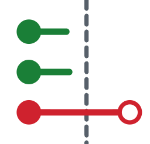
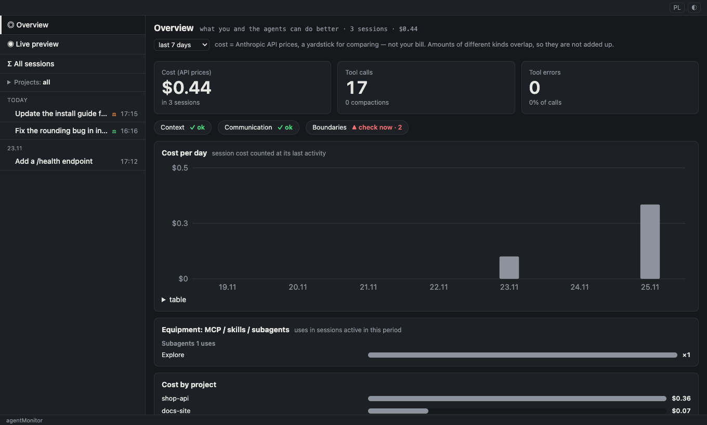
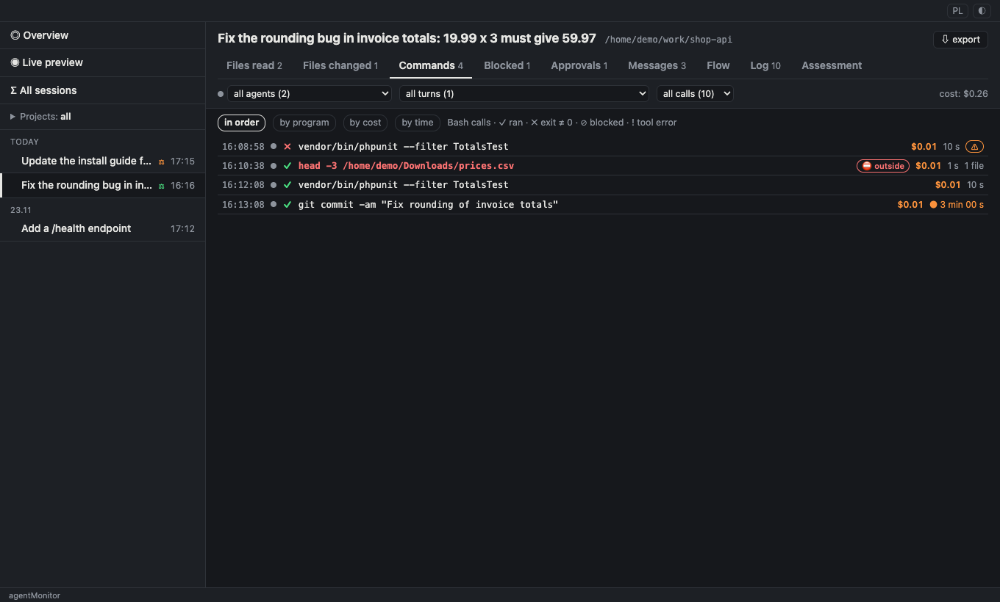
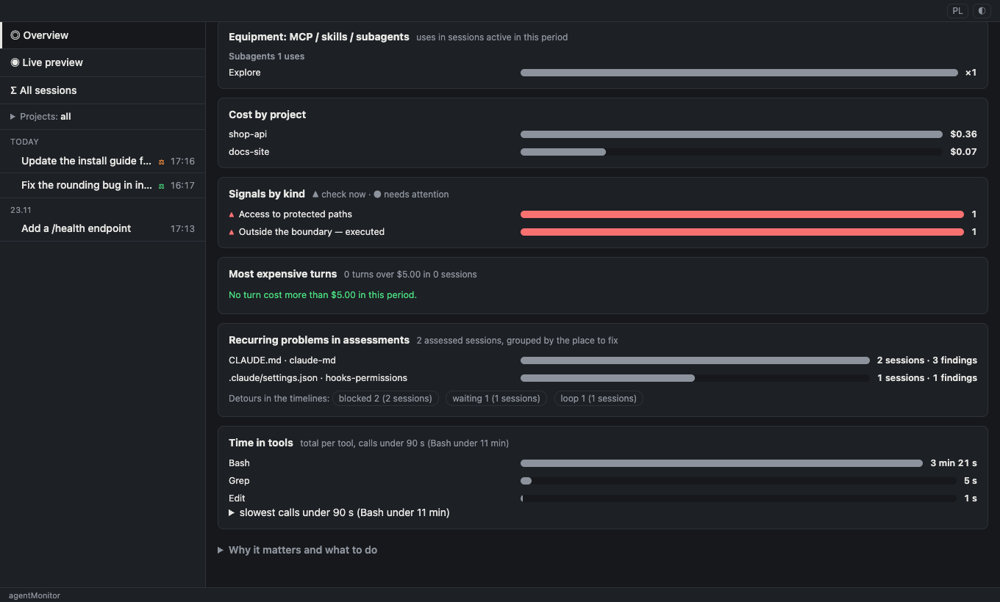
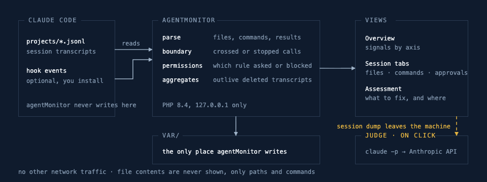

<picture>
  <source media="(prefers-color-scheme: dark)" srcset="https://github.com/SKrjwsk/agentMonitor/raw/HEAD/assets/logo-dark.png">
  
</picture>

# agentMonitor

**A local audit tool for Claude Code sessions: see what an agent read, changed and ran, where it crossed a permission boundary, and which rule or hook to fix. It writes only to its own `var/` folder.**

[](https://github.com/SKrjwsk/agentMonitor/actions/workflows/ci.yml)
[](LICENSE)
[](composer.json)

## Why

You let a Claude Code agent work for an hour. Afterwards you cannot say which files it opened, whether it left the folder you gave it, why it kept asking you for approval, or why it made the same mistake it made last week. The transcript has the answers, but it is a JSONL file that can reach tens of MB, and Claude Code deletes it after 30 days by default (`cleanupPeriodDays`).

agentMonitor reads those transcripts and turns every call into an answer: files read and changed, commands run, calls that left your boundary, and the rule or hook behind each approval prompt and block. On request, a model reviews a session and points to the file, rule or hook to change. Totals are kept in `var/summary/`, so they outlive the transcripts.



## Install

```bash
git clone https://github.com/SKrjwsk/agentMonitor.git
cd agentMonitor
```

PHP 8.4 or newer, macOS or Linux. There are no runtime dependencies, so nothing to install. Composer is only needed for the development tools.

Or paste this to your agent: *Clone `https://github.com/SKrjwsk/agentMonitor.git`, check that `php -v` is 8.4 or newer, run `php tests/run.php` and tell me whether it ends with `OK`. Then start `php bin/demo.php` and give me the URL. Do not bind the server to anything but 127.0.0.1, and do not run `bin/reset.php --yes`.*

## First use

```bash
php bin/demo.php                                  # synthetic sessions, http://127.0.0.1:8095/
php -S 127.0.0.1:8090 -t public public/index.php  # your own sessions, http://127.0.0.1:8090/
```

1. The demo needs no Claude Code sessions: it writes three made-up sessions into a temporary folder and serves a copy of the app on them. Nothing in `~/.claude` or in this repository is touched, and the session judge is switched off there.
2. Open the demo and look at **Overview**: the Boundaries axis is red because calls reached outside the work folder. Click through to the session, then to **Commands**, where that call is marked `outside`.
3. Start the second command to see your own sessions. It reads `~/.claude/projects/` and never writes there.



## Everyday use cases

- **Did the agent stay in its folder?** Set `AGENT_ALLOWED_RW` to the folders it may work in. Every call outside them is listed as executed, suspicious (paths cannot be resolved) or stopped by a hook, rule or the sandbox, with the command that did it.
- **Why does it keep asking me?** The **Approvals** tab shows each permission prompt and why it appeared: an `ask` rule from your settings, a protected path, or a command shape. A rule that outranks your `allow` shows up here instead of in a long debugging session.
- **Same mistake again and again.** On request, the session judge reads a session dump and writes findings, each with one owner: your prompt, `CLAUDE.md`, a rules file, a hook or the permissions. **Recurring problems** on the Overview groups findings across sessions by the file to fix.
- **What did last month cost, and what did it touch?** Per-session totals stay in `var/summary/` after Claude Code deletes the transcript. Cost per day, per project and per turn is computed at API list prices: a yardstick for comparing, not your bill.



## How it works



- **Read-only parsing.** agentMonitor reads Claude Code transcripts under `~/.claude/projects/` and recovers the files each call touched, including those named inside Bash commands (quotes, heredocs, redirects, variables, `cd`).
- **Boundary and permissions from your own settings.** The boundary comes from `AGENT_ALLOWED_RW` and `AGENT_ALLOWED_R`. Approval reasons come from the `permissions` key of your Claude Code settings; nothing else in those files is decoded.
- **Own storage.** Aggregates, session dumps and judgments live in `var/` (`0700`, files `0600`). `bin/reset.php` clears it.

To browse a transcript and reconstruct what was in the context window, [claude-devtools](https://github.com/matt1398/claude-devtools) goes further. agentMonitor is built for auditing what the agent did against the limits you set.

## Security

- Run it on `127.0.0.1`. Whatever address it is bound to, it rejects any request that does not come from the loopback address or carries a foreign `Host` header.
- **No network requests of its own.** One optional exception: the session judge. When you press the button in the Assessment tab, it starts `claude -p` on a dump of the session (commands, paths and your prompts, no file contents), and Claude Code sends that to the Anthropic API under your account. The judge has only `Read`, `Grep` and `Glob`, with reads pre-approved for the session dump and its own instructions file and everything else denied; this is best effort for `Grep` and `Glob` (details in [docs/security.md](docs/security.md)). The judge's own Claude Code run keeps a transcript in `~/.claude`, like any session.
- Only `GET`, `POST /export` and `POST /judge` are accepted, the two POSTs only from the app's own page. `/export` writes a dump to `var/session_dump/`; `/judge` starts the judge described above.
- Transcripts and hook data are untrusted: commands and paths may come from a prompt injection. Treat `var/` and exports like your terminal history, because a command can contain a password.
- agentMonitor installs no hooks. The optional live-feed hook (`bin/hook.php`) is added only by you, and it prints nothing and always exits 0.

Details, including what is read and the implementation guarantees: [docs/security.md](docs/security.md).

## Limitations

- The transcript format is internal and undocumented; it was checked on Claude Code 2.1.300. The UI warns when a large file yields no tool calls.
- Files read indirectly by programs (`php bin/console`, `composer`, `python3 - <<EOF`) are only flagged as "indirect".
- Cost is estimated from list prices (`src/Pricing.php`); a model without an entry shows `?`.
- The 3D Office view and the OS-log verification (`bin/verify.php`) are experimental: they have not been checked against real sessions.
- Claude Code deletes old transcripts; sessions already deleted keep their totals but lose the call-level views.

More: [usage and reference](docs/usage.md), [project page](https://skrjwsk.github.io/agentMonitor/), [changelog](CHANGELOG.md).

## License

[MIT](LICENSE)
